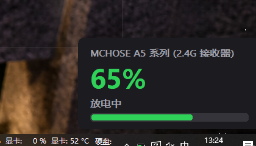

# MouseBattery

迈从（MCHOSE）A5 / AX5 系列鼠标的 **Windows 任务栏电量显示**小工具。

单文件 Win32 程序，无第三方依赖，编译产物约 70 KB：常驻托盘按电量变色，左键查看详情，
右键刷新 / 开机自启 / 退出，插拔接收器或鼠标休眠唤醒后自动重新读取。

> 本项目与迈从官方无任何关联。它不修改官方驱动、不写入设备，只通过 HID Feature Report
> 读取固件本来就会返回的电量字段。



## 功能

- 托盘图标按电量分级着色（≤20% 红、≤60% 黄、其余绿），充电时叠加闪电标记
- 左键弹出详情卡片：设备名、电量、充电状态、电量条
- 右键菜单：立即刷新、开机自启动（`HKCU\...\CurrentVersion\Run`）、退出
- 监听 `WM_DEVICECHANGE`，接收器插拔立即刷新
- 60 秒定时刷新；弹窗与菜单打开前会先取一次实时值
- 只认可有效响应帧，遇到未就绪帧时保留上次有效值，不会把 0% 当成真实电量

## 原理

官方驱动 `DriverCore.exe` 为 .NET 程序，通过 `SetupDi*` 枚举 HID 接口，用
`HidD_SetFeature` / `HidD_GetFeature` 收发 65 字节 Feature Report 完成电量查询。
本项目按同样的报文布局实现，协议要点：

| 项目 | 值 |
| --- | --- |
| 厂商 ID | `0x2023` |
| 报告长度 | 65 字节（`FeatureReportByteLength >= 65`） |
| 命令帧 | `buf[3]=0x02`、`buf[4]=0x02`、`buf[6]=0x83`，其余为 0 |
| 响应帧 | `buf[1]=0xA1` 表示命令已执行；`0xA0` 是未就绪回显，该帧电量恒为 0 |
| 充电标志 | `buf[7]`（1 = 充电中） |
| 电量 | `buf[8]`，0..100 |

设备匹配规则与官方 `GetTargetDev` 一致：**VID + PID + Feature 报告长度 == 65**，
不依赖 USB 复合设备接口号（`mi_0x`），因此在 2.4G 接收器、有线两种形态下都能命中。

### 关于“显示 0%”

接收器在收到查询后不一定立刻准备好数据，此时返回 `buf[1]=0xA0` 的未就绪回显帧，
其电量字段为 0。若只校验“值 ≤ 100”就会把 0 当成真实电量 —— 与官方驱动同时访问
同一个接收器时尤其容易出现。本程序的做法是：

1. 只接受 `buf[1]==0xA1` 的帧；
2. 失败按 50 / 100 / 200 / 400 ms 退避重试；
3. 仍失败则保留上一次有效值，并把托盘提示标记为陈旧数据。

## 支持的型号

| PID | 设备 |
| --- | --- |
| `0xF017` | A5 Pro（有线） |
| `0xF019` | A5 Pro Max（有线） |
| `0xF013` | A5 系列 2.4G 接收器（A5 Pro / A5 Pro Max 共用同一 PID） |
| `0xF015` | 通配接收器 |
| `0xF026` | AX5 Pro（有线） |
| `0xF022` | AX5 Pro Max（有线） |
| `0xF024` | AX5 系列 2.4G 接收器 |

由于无线形态下 A5 Pro 与 A5 Pro Max 共用 `0xF013`，程序只能显示为“A5 系列”，
无法从 PID 区分具体型号。

## 构建

需要 MinGW-w64（或 Dev-Cpp 自带的 32 位 MinGW），仅依赖系统库 `setupapi`、`hid`、`gdi32`。

```bat
:: 直接使用 PATH 中的 gcc
build.cmd

:: 或指定编译器目录
set GCC_DIR=D:\Soft\Dev-Cpp\MinGW32\bin
build.cmd
```

等价的手动命令：

```bat
gcc -O2 -mwindows -municode -o MouseBattery.exe mouse_battery.c -lsetupapi -lhid -lgdi32
gcc -O2 -mconsole -municode -o test_query.exe  test_query.c  -lsetupapi -lhid
```

## 使用

1. 双击 `MouseBattery.exe`，托盘出现电池图标；
2. 左键图标看详情，右键图标打开菜单；
3. 需要开机自动启动时，在右键菜单勾选“开机自启动”。

`MouseBattery.exe -demo` 启动时会直接弹出详情卡片，方便截图或调试。

## 验证读数

`test_query.exe` 使用与主程序完全相同的匹配规则和响应校验，并打印每一轮的原始
`seq / 电量 / 充电标志`，用于与官方驱动界面上的数值对照：

```text
设备: VID=2023 PID=F013  FeatureLen=65
  第1次(等 50ms) seq=A1 电量= 65% 充电=0
  => 有效读数: 65%
```

退出码：`0` 读到有效值，`2` 未读到有效值。

## 已知限制

- 只读电量与充电标志，不提供 DPI / 灯效 / 回报率等其他设置
- 未在全部 A5 / AX5 固件版本上验证，仅实际测试过 A5 Pro Max 1K
  (固件 `01.00.15.02`) 的 2.4G 接收器
- 电量刷新间隔 60 秒，插入充电线后状态可能延迟一个周期才反映

## 许可

[MIT](LICENSE)
